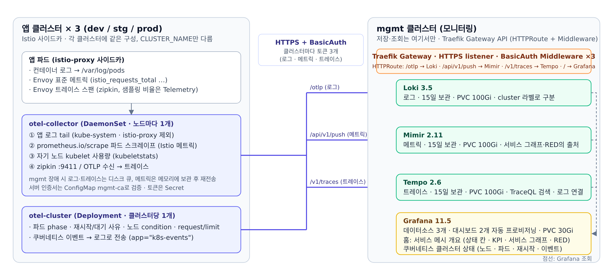
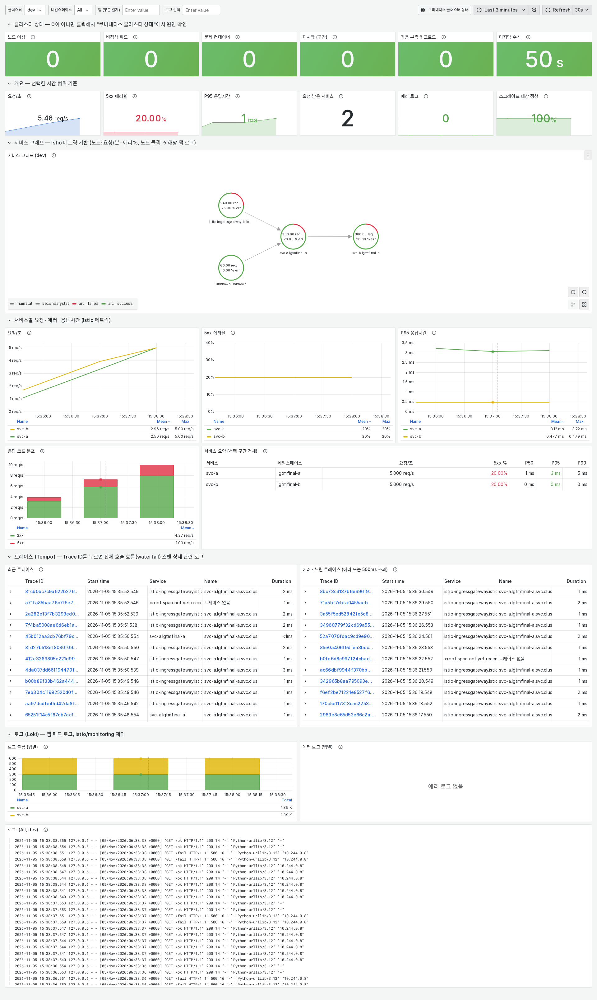
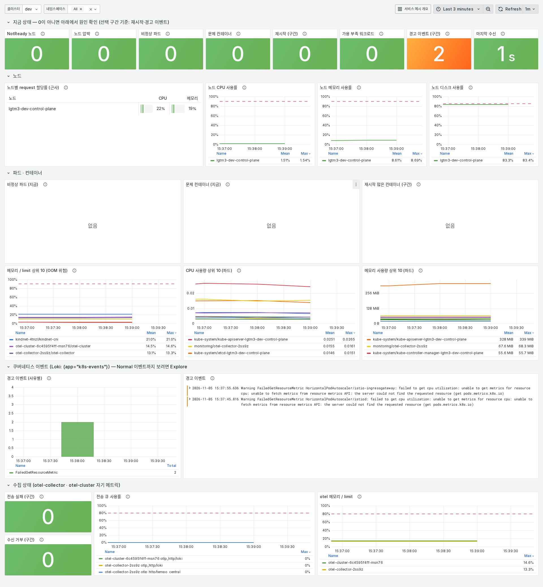

# Kubernetes LGTM Stack — 멀티클러스터 (mgmt 집중 수집)

Loki · Grafana · Tempo · Mimir를 **모니터링 클러스터(mgmt) 하나**에 두고, 애플리케이션 클러스터(dev / stg / prod)에는
OpenTelemetry Collector만 띄워 로그·메트릭·트레이스를 mgmt로 push하는 구성이다. 조회와 대시보드는 mgmt Grafana 한 곳에서 한다.

> 이전 버전(단일 클러스터, `observability` 네임스페이스, NFS StorageClass 포함)은 git 이력 `626f018`에 있다.

## 구조



(원본: `docs/architecture.svg`)

- **인증:** 클러스터마다 토큰 3개(로그·메트릭·트레이스). 평문은 그 클러스터의 Secret에, 해시는 mgmt Traefik BasicAuth에 들어간다.
  `configure.sh`가 둘 다 만들어 짝을 맞춘다. 하나가 유출돼도 그 클러스터의 토큰만 바꾸면 된다.
- **TLS:** otel은 `env`에 적은 CA로 mgmt 서버 인증서를 검증한다(`insecure_skip_verify` 없음).
- **서비스 그래프·RED 패널**은 Istio 표준 메트릭(`istio_requests_total` 등)으로 그린다. 트레이스는 Istio zipkin → otel → 중앙 Tempo.
- **mgmt가 잠시 죽어도** otel이 로그·트레이스는 디스크 큐(emptyDir 2Gi)에, 메트릭은 메모리에 들고 있다가 다시 보낸다(1시간 이내 장애는 유실 없음).
- **알림은 없다.** 대신 홈 대시보드 맨 윗줄 상태 칸이 빨강·주황으로 바뀐다. 폐쇄망처럼 밖으로 알림을 못 보내는 환경을 전제로 했다.
- 이미지는 전부 공개 이미지(docker.io) **digest 고정**이다. `install.sh`는 digest가 없는 `image:`가 있으면 멈춘다.

## 디렉토리

```
.
├── env.example        # 환경값: 도메인 4개, StorageClass, Gateway 이름, CA 경로, (선택) 미러 레지스트리
├── configure.sh       # env + secrets.env(없으면 생성) → build/ 렌더링. 템플릿은 건드리지 않는다
├── install/
│   ├── mgmt/          # 00-namespace, 01-loki, 02-mimir, 03-grafana(dashboards/), 04-tempo, install.sh
│   ├── dev/           # 00-namespace(mgmt CA), 01-otel, 02-istio(overlay·샘플링), install.sh
│   ├── stg/           # dev와 같고 CLUSTER_NAME만 stg
│   └── prod/          # dev와 같고 CLUSTER_NAME만 prod
├── build/             # configure.sh 산출물 (gitignore). install.sh는 여기서 실행한다
└── docs/              # 구조도, 대시보드 스크린샷
```

템플릿(`install/mgmt/`, `install/dev/` …)에는 `REPLACE_ME_*` 자리표시자가 있어서 그대로 apply할 수 없다. 값을 채운 사본이 `build/`에 생기고, `env`·`secrets.env`·`build/`는 커밋되지 않는다.

## 사전 조건

**mgmt 클러스터**
- Kubernetes 1.28 이상, RWO StorageClass
- Traefik v3 — Gateway API provider와 `traefik.io/v1alpha1` Middleware CRD. Gateway에 **HTTPS listener**가 있고,
  그 인증서 SAN에 도메인 4개가 들어 있으며, `allowedRoutes`가 `monitoring` 네임스페이스를 허용해야 한다
  (`from: All` 또는 namespace selector).
- 도메인 4개가 내부 DNS에서 그 Gateway를 가리켜야 한다. 앱 클러스터의 파드가 이 이름으로 접속한다.

**dev / stg / prod**
- Istio 컨트롤플레인이 이미 설치돼 있고, 설치에 쓴 **IstioOperator 파일**과 같은 버전의 `istioctl`이 있어야 한다
  (`02-istio/operator.yaml`은 설치가 아니라 그 위에 덧씌우는 overlay).
- 앱 네임스페이스에 `istio-injection: enabled`, 앱 파드에 `app: <서비스명>` 라벨(대시보드의 로그 링크가 이 라벨을 쓴다).
- `/var/log/pods`를 읽기 위해 otel은 GID 0으로 뜬다(UID는 65534 비root). PSA `restricted` 네임스페이스면 예외가 필요하다.

**작업 PC**
- `kubectl`(클러스터와 마이너 버전 ±1), `openssl`, `bash` 4 이상, 클러스터 4개의 kube context. `htpasswd`는 있으면 쓰고 없으면 openssl로 대체한다.

## 설치

### 1. 값 채우기

```bash
cp env.example env && vi env        # 도메인 4개, StorageClass, Gateway, CA PEM 경로
./configure.sh                      # secrets.env(토큰 9개·해시·Grafana admin 비밀번호, 600) 생성 → build/ 렌더링
```

마지막에 출력되는 **Grafana admin 비밀번호**를 기록한다(`secrets.env`에도 있다). `configure.sh`는 몇 번 실행해도 되고,
비밀값은 `secrets.env`에 없는 것만 새로 만든다. YAML을 직접 편집하지 않는다 — 값은 전부 `env`와 `secrets.env`에서 온다.

### 2. mgmt

```bash
MGMT_CTX=<mgmt kube context>; DEV_CTX=<dev>; STG_CTX=<stg>; PROD_CTX=<prod>   # kubectl config get-contexts
kubectl config use-context "$MGMT_CTX" && EXPECT_CONTEXT="$MGMT_CTX" build/mgmt/install.sh
```

끝에 출력되는 Route 표에서 4개 모두 `ACCEPTED`·`REFS`가 `True`인지 본다. 이어서 push 경로 3개를 토큰으로 점검한다.
DNS, TLS, Route, BasicAuth가 한 번에 확인된다.

```bash
set -a; . ./env; . ./secrets.env; set +a
chk() { curl -s -o /dev/null -w '%{http_code}' --cacert "$MGMT_CA_PEM" ${2:+-u "$2"} -H 'Content-Type: application/json' -d '{}' "$1"; }
L=https://$LOKI_DOMAIN/otlp/v1/logs; M=https://$MIMIR_DOMAIN/api/v1/push; T=https://$TEMPO_DOMAIN/v1/traces
echo "인증 없음: loki=$(chk $L) mimir=$(chk $M) tempo=$(chk $T)"                                   # 전부 401
for c in dev stg prod; do C=${c^^}; l=${C}_LOKI_TOKEN; m=${C}_MIMIR_TOKEN; t=${C}_TEMPO_TOKEN
  echo "$c: loki=$(chk $L "$c:${!l}") mimir=$(chk $M "$c:${!m}") tempo=$(chk $T "$c:${!t}")"; done   # 401이 아니면 통과 (빈 요청이라 loki 422, mimir 400, tempo 200이 정상)
```

| 결과 | 원인 |
|---|---|
| `000` | DNS 또는 TLS. `MGMT_CA_PEM`이 서버 인증서를 발급한 CA인지 확인 |
| `404` | Route가 Gateway에 안 붙었거나(위 표), 도메인이 다른 서버로 간다 |
| 토큰을 넣었는데 `401` | 해시와 토큰이 어긋남. `secrets.env`에서 그 줄을 지우고 `configure.sh` → mgmt `install.sh` 재실행 |

### 3. dev → stg → prod

클러스터마다 아래 블록을 값만 바꿔 실행한다. 앞 단계가 실패하면 뒤 단계(Istio 변경·앱 재시작)를 하지 않는다.

```bash
CTX="$DEV_CTX"; C=dev                       # ← stg: CTX="$STG_CTX"; C=stg / prod: CTX="$PROD_CTX"; C=prod
IOP=/path/to/istio-operator-dev.yaml        # ← 이 클러스터에 Istio를 설치할 때 쓴 IstioOperator (절대경로)
APP_NS="shop-dev payment-dev"               # ← istio-injection이 켜진 앱 네임스페이스들
( kubectl config use-context "$CTX" && EXPECT_CONTEXT="$CTX" "build/$C/install.sh" || exit 1
  istioctl install -f "$IOP" -f "build/$C/02-istio/operator.yaml" -y || exit 1     # 반드시 기존 IstioOperator 뒤에 overlay로
  kubectl apply -f "build/$C/02-istio/telemetry-sampling.yaml" || exit 1
  kubectl -n istio-system get cm istio -o jsonpath='{.data.mesh}' | grep -q 'otel-collector.monitoring.svc.cluster.local' || exit 1
  for ns in $APP_NS; do kubectl -n "$ns" rollout restart deploy || exit 1; done     # 사이드카가 새 설정을 받도록
) && echo "$C OK" || { echo "!! $C 설치 중단 — 위 오류 확인, 다음 클러스터로 넘어가지 말 것"; false; }
```

`02-istio/operator.yaml`을 **단독으로** `istioctl install` 하면 patch가 아니라 기본 프로필로 재설치돼 기존 설정이 사라진다.
prod는 `02-istio/telemetry-sampling.yaml`의 `randomSamplingPercentage: 100`이 운영 트래픽에 비해 과하면 먼저 낮춘다
(트레이스 저장량만 줄고 메트릭 기반 패널은 영향 없음).

### 4. 검증

| 확인 | 방법 | 기대 결과 |
|---|---|---|
| 파드 | `kubectl -n monitoring get pods` (각 클러스터) | 모두 Running. otel-collector는 노드 수만큼, otel-cluster는 1개 |
| 전송 | 각 클러스터 폴더 README의 otel 루프를 1분 간격으로 두 번 | `sent_*`가 늘고 `send_failed_*`가 없거나 안 늘며 `queue_size` 0 |
| 로그 | Grafana → Explore → Loki `{cluster="dev"}` | 앱 로그 |
| 메트릭 | Explore → Mimir `sum by (destination_canonical_service) (rate(istio_requests_total{cluster="dev", reporter="destination"}[5m]))` | 요청을 보낸 뒤 1~2분 안에 서비스별 요청률 |
| 트레이스 | Explore → Tempo → TraceQL `{ resource.cluster = "dev" }` | 트레이스 목록, 클릭하면 waterfall과 관련 로그 링크 |
| 대시보드 | Grafana 홈 | 서비스 메시 개요(아래 스크린샷). 클러스터 상태 6칸, KPI, 서비스 그래프, RED, 트레이스·로그 패널 |
| 클러스터 상태 | Dashboards → Kubernetes → 쿠버네티스 클러스터 상태 | 맨 윗줄 8칸이 채워지고 "마지막 수신"이 3분 이내 |

서비스 그래프와 트레이스는 선택한 시간 범위 안에 요청이 있어야 나온다.

**검증 이력** — 2026-11-05, kind 클러스터 2개(mgmt·dev, Kubernetes 1.31.14), Traefik 3.6.7, Istio 1.30.2, 공개 이미지 그대로.
이 README의 1~3단계 블록을 그대로 실행해 설치했고, 비메시 파드에서 10분 부하(게이트웨이 2,400건 + 직접 호출 600건)를 걸어
서비스 그래프 수치(240 / 300 / 60 req/min, 에러 25 / 20 / 0 %)가 실제 호출 수와 일치하는 것을 확인했다. 위 검증표의 행은 모두 통과했고,
아래 스크린샷은 그 환경에서 찍은 것이다. 확인하지 않은 것: 다중 노드, stg·prod 동시 설치, 사설 미러 레지스트리, 실제 내부 DNS(시험은 nip.io).

## 대시보드

둘 다 `install/mgmt/03-grafana/dashboards/`의 JSON이고 `install.sh`가 ConfigMap으로 프로비저닝한다(Grafana UI에서 수정 불가, 파일을 고쳐 재배포).

**서비스 메시 개요** (홈) — 클러스터·네임스페이스·앱 변수. 맨 위 상태 6칸(문제 파드, 재시작, 노드, 전송 실패 …), KPI 6개,
Istio 메트릭 기반 서비스 그래프(`req/min · % err`), 서비스별 요청률·5xx·P95, 응답 코드, 요약 표, 트레이스 검색, 로그.



**쿠버네티스 클러스터 상태** — 클러스터별 노드·파드·컨테이너 상태, 재시작, 대기 사유, request 할당률, 이벤트 목록.
상태 칸을 누르면 원인 패널로 간다.



## 운영

- **토큰 교체:** `secrets.env`에서 바꿀 줄 두 개(예: `DEV_LOKI_TOKEN`, `DEV_LOKI_HASH`)를 지우고 `./configure.sh` →
  mgmt `install.sh`(새 해시 적용) → 그 클러스터 `install.sh`(Secret이 바뀌면 otel을 자동 재시작).
- **CA 교체:** 서버 인증서를 바꾸기 **전에** 옛 CA와 새 CA를 이어 붙인 PEM을 `MGMT_CA_PEM`으로 두고 `configure.sh` →
  dev/stg/prod `install.sh`(ConfigMap이 바뀌면 자동 재시작) → mgmt 서버 인증서 교체 → 새 CA만으로 반복.
- **보존·용량:** Loki·Mimir·Tempo 15일, PVC 100Gi. 샘플링 100%에서 100 req/s면 트레이스가 하루 5~7GB라 15일이면 거의 찬다.
  운영 트래픽이 그 수준이면 샘플링을 낮추거나 PVC를 키운다. PVC 크기는 처음 만들 때만 적용된다.
- **되돌리기:** 이전 커밋을 checkout해 `configure.sh`(같은 `secrets.env`) → 해당 `install.sh`. ConfigMap만 바뀐 경우도 `install.sh`가 재시작까지 한다.
- **otel-cluster는 반드시 1개.** 늘리면 같은 값이 중복으로 들어간다.
- **스크레이프 간격은 1분.** 새 패널에서 `rate(x[1m])`을 쓰면 값이 비니 `$__rate_interval`이나 4m 이상을 쓴다.

## 문제가 생기면

```bash
set -a; . ./env; set +a                       # 저장소 루트에서. 앱 클러스터 context로 전환한 뒤 실행
kubectl -n monitoring get pods -o wide
kubectl -n monitoring describe pod -l app.kubernetes.io/name=otel-collector | sed -n '/^Events:/,$p'
kubectl -n monitoring logs ds/otel-collector --tail=300 | grep -E 'error|failed' | tail -5
kubectl --context "$MGMT_CTX" -n "$GATEWAY_NAMESPACE" logs -l app.kubernetes.io/name=traefik --tail=300 | grep -iE 'error|basicuser' | tail -5
```

| 증상 | 원인 | 조치 |
|---|---|---|
| `ContainerCreating` + Events `configmap "otel-collector" not found` / `"mgmt-ca" not found` | ConfigMap 없이 DaemonSet만 apply됨 (파일을 하나씩 apply한 경우) | `build/<c>/install.sh` 재실행 |
| `install.sh`가 `REPLACE_ME 값이 남아 있음` | 템플릿 폴더에서 실행했거나 `configure.sh`를 안 거침 | `./configure.sh` 뒤 `build/…/install.sh` |
| otel 로그 `404` + Traefik 로그 `error parsing BasicUser: <값>` | BasicAuth `users` 줄이 `사용자:해시` 꼴이 아님(평문 토큰·따옴표·공백). Traefik은 그 Route를 통째로 버린다 | YAML을 손으로 고치지 말고 `configure.sh` → mgmt `install.sh` |
| otel 로그 `404`, Traefik 로그에 오류 없음 | Route 미부착 또는 도메인이 다른 서버로 감 | mgmt `install.sh` 끝의 Route 표, 노드에서 `curl -w '%{remote_ip}'`로 받은 IP가 Gateway인지 |
| otel 로그 `401` | 토큰·해시 불일치, 또는 Secret을 바꾼 뒤 파드가 옛 값을 들고 있음 | 위 `chk`로 mgmt 쪽부터 확인 → 그 클러스터 `install.sh`(변경 감지 시 자동 재시작) |
| otel 로그 `x509: certificate signed by unknown authority` | `MGMT_CA_PEM`이 서버 인증서를 발급한 CA가 아님 | 올바른 CA로 `configure.sh` → 그 클러스터 `install.sh` |
| `sent_*`가 안 늘어남 | 전송 실패(위) 또는 보낼 것이 없음 | `send_failed_*`·`queue_size`. otel-cluster의 로그 카운터는 이벤트라 조용하면 안 는다(정상) |
| Istio 메트릭이 비어 있음 | `telemetry-sampling.yaml` 미적용 (`metrics: prometheus`가 여기 있다) | 3단계 블록 재실행 |
| Grafana 로그인 불가 | 비밀번호는 `secrets.env`의 `GRAFANA_ADMIN_PASSWORD` | 잃어버렸으면 그 줄을 지우고 `configure.sh` → mgmt `install.sh` → `kubectl -n monitoring rollout restart deploy/grafana` |
